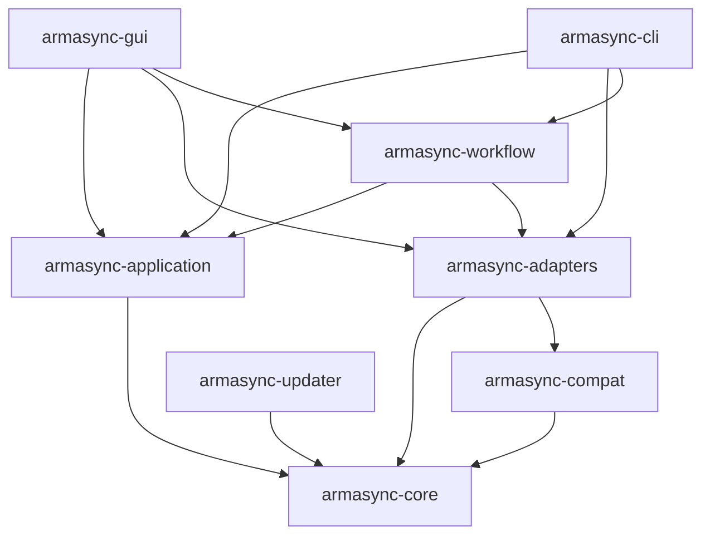

# Rust-Zielarchitektur

Status: Plan, noch nicht implementiert. Rust als Produktkern ist vorgegeben; konkrete Bibliotheksversionen und GUI-Toolkit werden in P1 anhand aktueller Dokumentation und Prototypen entschieden. Native Rust-GUI bevorzugt. Siehe [ADR-0001](../adr/0001-rust-workspace.md) und [ADR-0002](../adr/0002-gui-toolkit.md).

## Abhängigkeiten



Die Frontends sind Composition Roots: sie erstellen die konkreten Adapter und injizieren sie in die Application-Services. `application` kennt nur Core-Ports, nicht die konkreten Adapter. Fachliche Typen, Fehler und Events fließen nach außen; GUI-Zustände oder Terminalformatierung fließen nicht in den Core.

## Geplantes Layout

```text
Cargo.toml                         # Workspace, in P1 anlegen
Cargo.lock                         # durch einen Integrator pflegen
rust-toolchain.toml                # verifizierte stabile Toolchain pinnen
crates/
  armasync-core/                   # Modelle, Regeln, SyncPlan, Ports
  armasync-application/            # Use-Cases, Jobs, Policies, Koordination
  armasync-adapters/               # FS, HTTP, Credentials, OS, Persistenz
  armasync-cli/                    # clap, JSON, Exitcodes
  armasync-gui/                    # Desktop-UI, Viewmodels, Event-Übersetzung
  armasync-compat/                 # begrenzter Legacy-Datenparser
  armasync-updater/                # später separater, minimal privilegierter Prozess
tests/fixtures/                    # synthetische oder freigegebene Daten
docs/adr/                          # Entscheidungen und verworfene Optionen
docs/tasks/                        # getrennte Arbeitsaufträge
docs/changes/                      # separate Änderungsnachweise
docs/handoffs/                      # Übergaben je Task
```

P1 beginnt mit Core, Application, Adapters, CLI und einem kleinen GUI-Prototyp. Compat und Updater erst bei tatsächlichem Bedarf ausgliedern; keine leeren Plugin-/Microservice-Gerüste. Die Trennung in Core/CLI/GUI bleibt verbindlich. Netzwerkadapter dürfen zunächst getrennte Module im Adapter-Crate sein, später bei unabhängigen Abhängigkeiten eigene Crates werden.

## Verantwortlichkeiten

| Modul | Enthält | Darf nicht enthalten |
| --- | --- | --- |
| Core | RepositoryId, ProfileId, relative Repositorypfade, Manifest, Hasharten, Diff-/Löschregeln, SyncPlan, Ports, ErrorKind, OperationEvent | GUI, globaler Zustand, Shellaufrufe, konkrete Netzwerk-/OS-Bibliotheken |
| Application | Import, Scan, Plan, Sync, Verify, Build, Upload, Profile; Job-Lebenszyklus, Cancellation, Transaktionen | UI-Widgets, Terminalausgabe, statische Singleton-DAOs |
| Adapters | HTTP/FTP/SFTP/WebDAV, FS, Hashing-I/O, sichere Credentials, Pfade, Prozess-/Registryintegration | alternative Implementierung fachlicher Regeln |
| CLI | Argumentvalidierung, Ausgabe, Signalbehandlung, Exitcode-Zuordnung | eigener Syncalgorithmus, Displayserver-Abhängigkeit |
| GUI | Navigation, zugängliche Controls, bestätigte Eingriffe, Viewmodels, lokalisierte Meldungen | eigener Download-/Dateilöschcode oder blockierendes I/O im UI-Thread |
| Compat | Untrusted Bytes → validiertes neutrales DTO → Core-Modell | Laden/Ausführen von Java-Klassen, alte Namen als eigene Typidentität |
| Updater | signierte Pakete prüfen, stagen, tauschen, zurückrollen | Speichern von Repositorycredentials, beliebige Postinstall-Skripte aus Metadaten |

## Gemeinsame Verträge

Vor paralleler Implementierung in einem ADR und getesteten Rust-Typen fixieren:

- `OperationId`/`RepositoryId` als stabile IDs, nicht Anzeigenamen als Schlüssel.
- `SyncPlan` mit Quellrevision, Zielroot, Schritten `Download`, `Replace`, `Keep`, optional `Delete`, Summen und Warnungen. Plan vor Anwendung gegen Revision/FS-Zustand neu validieren.
- Use-Cases `inspect_repository`, `plan_sync`, `apply_sync`, `verify`, `build_repository`, `upload_repository`, `import_legacy` mit typisierten Ein-/Ausgaben. Noch keine behaupteten existierenden APIs.
- Events mit Schema-Version, Operation-ID, Sequenz, Phase, Bytes/Dateien, Zeitpunkt und typisiertem Fehler. Kein Kennwort, Token, privater URL-Query oder lokalem Secret im Event.
- Jobs `Queued → Running → {Succeeded,Failed,Cancelled}`; Pausieren/Fortsetzen nur mit wirklich persistiertem Resumezustand. Abbruch ist eigener Zustand, kein Erfolg.
- Portfähigkeiten `list/stat/read_range/write/rename/delete`, Auth-/TLS-/SSH-Optionen und Protokollfeature-Matrix. Unterstützte Fähigkeiten explizit abfragen.
- Versionierte persistente Formate und Migrationsschritte; unbehandelte neuere Versionen sicher ablehnen. Keine Speicherung von Rust-Speicherlayout.

## Bibliotheksrichtungen, keine ungeprüften Versionsvorgaben

`serde`/`serde_json` für Daten, TOML für Einstellungen, `thiserror` für interne Fehler, `clap` für CLI, `tracing` für strukturierte Diagnose. Async-I/O etwa mit Tokio; Hash-/Kompressionsarbeit in begrenzte Blocking-Pools. HTTP etwa über Reqwest/Rustls; SFTP/FTPS/WebDAV anhand Serverinteroperabilität, Lizenzen und Systembedarf auswählen. Keine Pflicht, jeden Adapter async zu implementieren, wenn die sichere Bibliothek synchron ist.

OS-Keyring unter Windows und Secret Service unter Linux evaluieren; für headless Hosts ohne Schlüsselbund explizite kurzlebige Credential-Zufuhr ermöglichen und Persistenz nicht stillschweigend als Klartext implementieren. Rust-Core kennt nur `CredentialRef`, keine serialisierten Kennwörter.

## Build- und Plattformgrenzen

- CLI-Binary `armasync`, GUI-Binary `armasync-gui`; sichtbare App/Startmenüeinträge **ArmaSync**, Publisher **Lynxnode.it**. GUI ist Standarddownload und Desktop-Hauptzugang.
- `cargo build -p armasync-cli --locked` muss ohne GUI-Dependencies, X11/Wayland oder WebView-Setup funktionieren. Workspace-Mitgliedschaft darf diese Trennung nicht aufheben.
- GUI-/OS-Abhängigkeiten in ihren Crates und `cfg(target_os)` kapseln. Linux unterstützt Synchronisation; Windows-Launcher kann als separate Capability fehlen.
- Windows x86_64 MSVC und Linux x86_64 GNU zuerst prüfen; Distribution-/Mindestversionen nach P1-Prototyp festschreiben. ARM/macOS sind keine impliziten Zusagen.
- Config: Windows `%APPDATA%\Lynxnode.it\ArmaSync`, Daten/Cache `%LOCALAPPDATA%\Lynxnode.it\ArmaSync`; Linux `$XDG_CONFIG_HOME/lynxnode/armasync`, `$XDG_DATA_HOME/lynxnode/armasync`, `$XDG_CACHE_HOME/lynxnode/armasync`, jeweils mit Standardfallbacks. Portable Nutzung explizit wählen und Schreibrechte prüfen.
- Neues Produkt parallel zum Bestand installieren; kein ungeprüftes Überschreiben alter Installations-IDs. Import kopiert Daten und lässt Rückkehr zu `legacy` zu.
